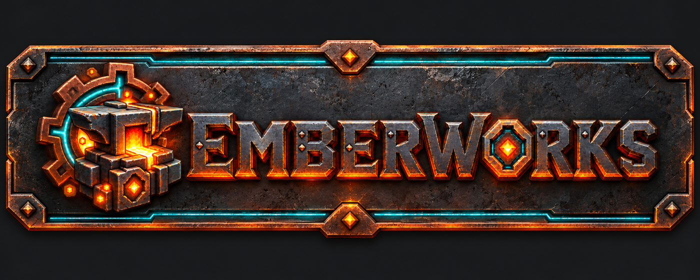

# Emberworks player guide

[Read the guide](https://jkswoods.github.io/emberworks-docs/) · [First useful loop](docs/getting-started.md) · [Machine guide](docs/features/index.md)



Build a connected workshop with industrial machines, Flux power, material routing and finite water and chemical stores.


*Native Hytale 0.7.2 development workshop. This creative test layout illustrates the documented snapshot; it does not establish full survival or current private-build acceptance.*

- Generate and distribute Flux power through a workshop.
- Process materials with native machine controls and recipes.
- Route items, water and chemicals between the documented machines.

This repository publishes the **earlier 0.3.0-dev guide for Hytale 0.7.2**, with curated documentation and reviewed web media. No public playable JAR or download is available. Read [installation and support limits](docs/installation.md) before using a supplied development candidate. Human sound/visual acceptance, real multiplayer and full survival acquisition remain incomplete.

## Build the guide

Use Python 3, install `requirements-docs-lock.txt`, then build the exact documentation snapshot:

```sh
python -m pip install -r requirements-docs-lock.txt
python -m mkdocs build --strict
```

Preview with `python -m mkdocs serve` and inspect the printed URL. Documentation deployment is separate from any mod release. The source/asset license and required notices are retained.
