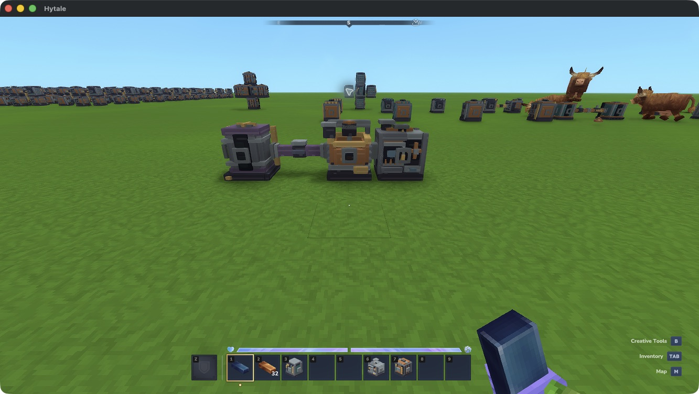
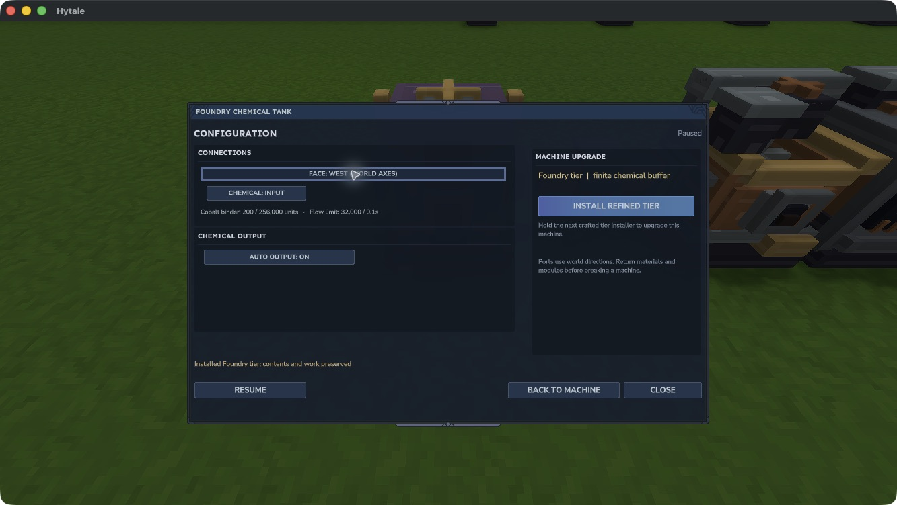
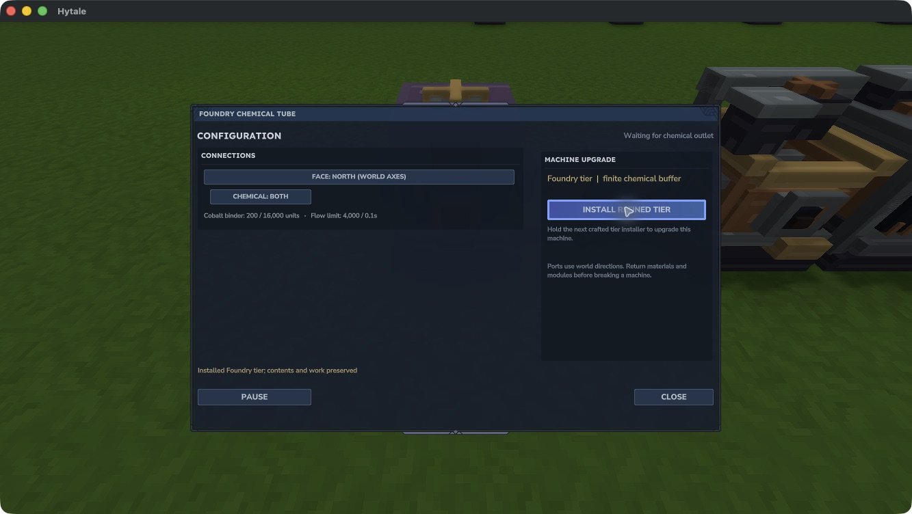

# Chemical tanks and tubes

Chemical Tanks and Chemical Tubes store and route finite **Carbon** or **Cobalt binder**. A component holds one identity at a time. These stores are separate from water and milk; transport needs no Flux.

This is a development feature for the supported test setup. A native tank → tube → Crucible loop has produced one Tempered Alloy, including a paused paid batch across normal reload. Binder rejection, return, carrier recovery and stocked Foundry upgrades have also been exercised. Complete survival crafting, ordinary Use input, human listening and real multiplayer remain under acceptance.

*A finite native layout. The Dynamo powers the Crucible; the tank and tube carry its matching chemical. See the [build and backup guidance](../installation.md) before opening a save with these components.*

## Load or recover a carrier

Open the owned tank while standing nearby. The development command `/emberworks x y z` opens its panel within eight blocks. A tube opens configuration directly.

1. **Pause** the tank and hold ordinary Charcoal or a Cobalt bar.
2. Select **Load held carrier**. Each Charcoal supplies **10 Carbon units**; each Cobalt bar supplies **200 binder units**. The whole held stack must fit.
3. To recover stock, pause the tank and select **Recover to hand**, holding either an empty hand or the matching ordinary carrier.

Recovery returns whole carrier items into at most one 100-item held stack. Overflow and smaller chemical residues stay in the tank. Customized carriers and mixed chemical identities refuse without spending materials.

*This stocked tank retained its 200 binder units, pause, West Input and Auto output setting through a Foundry installation. Recovery then returned the original Cobalt bar.*

## Route to a matching machine

Place face-adjacent tubes between the tank and a consumer. The **Alloy Crucible accepts Carbon**; the **Pressure Forge accepts Cobalt binder**. A mismatched consumer leaves stock upstream.

- Tanks keep their stock by default. Enable **Auto output** to send through permitted output faces.
- Alternatively, set the adjoining tube face to **Input** to pull from an enabled tank. A tube cannot drain a consumer's paid chemical reserve.
- In **Configure**, select a world-axis face and cycle its **Chemical** port through Both, Closed, Input and Output.
- Both endpoints must be enabled, loaded, available and owned by the same player. Closed, unavailable or incompatible routes stop transfer. Full destinations preserve upstream stock until room appears.

*The tube keeps incompatible binder instead of forcing it into the Crucible. Setting the tank's adjoining face to Input returned the binder for recovery.*

For a Carbon alloy batch, supply the Crucible with **one Iron Ingot, 20 Carbon and 6,000 Flux**. Auto selects the matching recipe. A paid batch reserves its Carbon across pause and reload; it cannot be recovered as spare stock. See the [processing catalog](../recipes.md) for the current recipe contracts.

## Finite tiers and crafting

| Tier | Tank capacity | Tube capacity | Tank units per 0.1s | Tube units per 0.1s |
|---|---:|---:|---:|---:|
| Standard | 64,000 | 4,000 | 2,000 | 1,500 |
| Foundry | 256,000 | 16,000 | 32,000 | 4,000 |
| Refined | 1,024,000 | 256,000 | 256,000 | 128,000 |
| Precision | 8,192,000 | 1,024,000 | 1,024,000 | 512,000 |
| Resonant | 16,384,000 | 4,096,000 | 2,048,000 | 1,024,000 |

All incoming connections share the receiving component's limit; all outgoing connections share its sending limit. Resonant remains finite.

The authored Standard tank recipe uses **10 Iron Ingots, 4 Copper Ingots and 4 Tempered Alloy**. **3 Iron Ingots, 2 Copper Ingots and 1 Tempered Alloy** make **4 Standard tubes**. Higher variants require the previous component and matching next-tier installer. The [Workbench table](../crafting.md) lists the actual authored recipes; a listed recipe does not establish a completed survival acquisition journey.

Hold the next installer and select its control in **Configure** to upgrade a placed component. Stock and settings are retained. Empty chemical buffers before removal. Back up the complete paired world, player data and JAR before changing builds.
