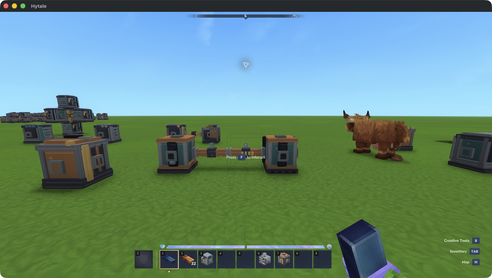
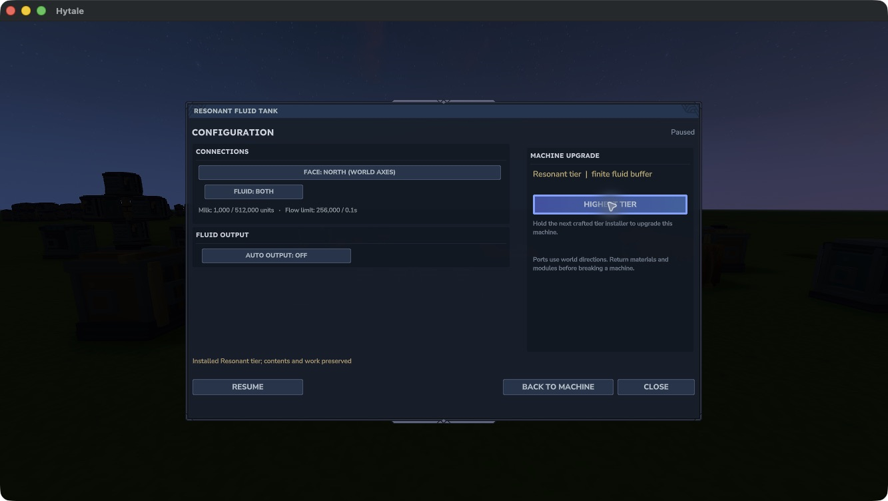
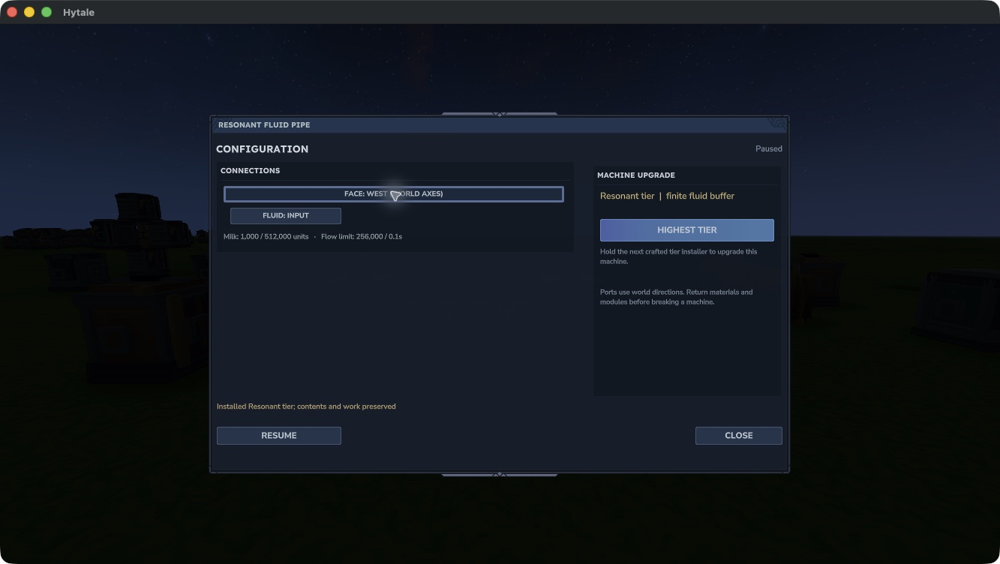

# Fluid tanks and pipes

Fluid Tanks and Fluid Pipes store and move finite water, milk and Mosshorn milk. One full native bucket exchanges **1,000 local fluid units**. Each component holds one fluid identity at a time. Transport needs no Flux.

This is a development feature for the supported test setup. Native water/milk transport, carrier exchange, tier installation and normal reload have been exercised. The milk tests used granted native carriers; natural milk acquisition, the complete survival crafting journey, ordinary Use input, human listening and real multiplayer remain under acceptance.

*A native test layout: stored fluid moves through face-adjacent pipes into a receiving tank. These screenshots use the fluid-network build identified on the [compatibility page](../installation.md).*

## Fill a tank

Open a tank's controls while standing nearby. The development command `/emberworks x y z` opens the owned component within eight blocks. A pipe opens its configuration directly; a tank has **Configure** beside its pause control.

1. **Pause** the tank and hold one ordinary full water, milk or Mosshorn milk bucket.
2. Select **Load held full bucket**. The tank gains 1,000 units and the empty bucket remains in your hand.
3. To take fluid back, pause the tank, hold an ordinary empty bucket and select **Fill held empty bucket**. This needs at least 1,000 matching units.

Customized, partly used, incompatible or mixed-fluid carriers refuse the exchange. The Intake Pump and Floodgate remain water-only.

*The configuration shows exact quantity, capacity, flow limit and the selected world-axis face. A paused tank retains its stock even beside an active Input-only pipe.*

## Connect and move fluid

Place face-adjacent pipes between a source and a receiving tank. Components must be loaded, enabled and owned by the same player. Select a world face in **Configure**, then cycle its **Fluid** port through Both, Closed, Input and Output.

- A tank keeps its contents by default. Turn **Auto output** on to send through permitted output faces.
- Alternatively, set the adjoining pipe face to **Input** to pull from an enabled tank or Pump. This does not bypass pause or ownership.
- Receiving tanks use Auto output Off, or an explicit Input face. Resume both the route and the receiving tank.
- Closed, paused, missing, unloaded, differently owned or incompatible-fluid components stop that path. Full destinations leave fluid in finite upstream buffers; they do not discard it.

*This pipe retained the same milk and West Input port through all four installed upgrades. Resume the route when the receiving tank has room.*

## Finite tiers and crafting

| Tier | Tank capacity | Pipe capacity | Tank units per 0.1s | Pipe units per 0.1s |
|---|---:|---:|---:|---:|
| Standard | 32,000 | 2,000 | 2,000 | 500 |
| Foundry | 64,000 | 8,000 | 8,000 | 2,000 |
| Refined | 128,000 | 32,000 | 32,000 | 16,000 |
| Precision | 256,000 | 128,000 | 128,000 | 64,000 |
| Resonant | 512,000 | 512,000 | 256,000 | 256,000 |

All incoming connections share the receiver's limit; all outgoing connections share the sender's limit. Resonant remains finite. There is no infinite-supply or voiding variant.

The authored Workbench recipe for a Standard tank uses **8 Iron Ingots, 4 Copper Ingots, 2 Tempered Alloy and 1 Wooden Bucket**. **2 Iron Ingots and 2 Copper Ingots** make **4 Standard pipes**. Higher variants use one previous-tier component and one matching next-tier installer. See the [actual crafting table](../crafting.md) for names and ingredients; recipe presence does not establish completed survival acquisition.

Hold the next installer and use the component's configuration to upgrade an existing block. Stored type, quantity, ports and pause state are retained. Empty a component before removal. Back up the paired world, player data and matching JAR before changing builds; older builds may not understand these saves.
