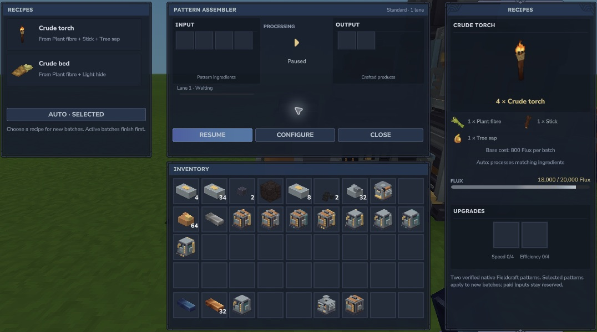

# Local media and patterns

## Alloy Crucible

Use either the direct iron-bar plus two-charcoal recipe, or fill its separate carbon store while paused. One charcoal provides 10 carbon; the carbon recipe reserves 20 units per alloy. The store holds 1,000 units. Whole unreserved charcoal can be recovered to the held slot.

*Carbon quantity, available carrier actions and saved recipe choice are visible independently of the item grids.*

## Pressure Forge

Pause to load held Cobalt bars: one bar provides 200 binder units in a 1,000-unit local store. Lumen grit or Void grit plus 200 binder and 5,000 base Flux yields the corresponding ingot. Binder is consumed against paid work; a reload cannot give that paid media back for free. Reserve enough media for all intended lanes.

## Pattern Assembler

The first native pattern set contains **Crude torch** and **Crude bed** (the stock Crude Bedroll item), derived from the installed Fieldcraft recipes. This is a finite pattern set, not arbitrary crafting support.

*Torch: one Plant fibre + one Stick + one Tree sap → four torches, 800 base Flux. Bed: three Plant fibre + two Light hide → one bed, 1,200 base Flux.*

Pause to arrange ingredients if needed. Resume to process the selected pattern or leave Auto. Output fit is checked conservatively. Changing selection applies to new batches; inputs already reserved for a paid pattern remain with that pattern across reload.
