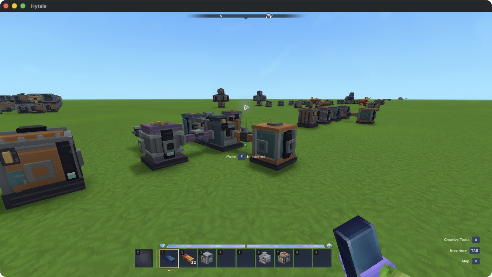
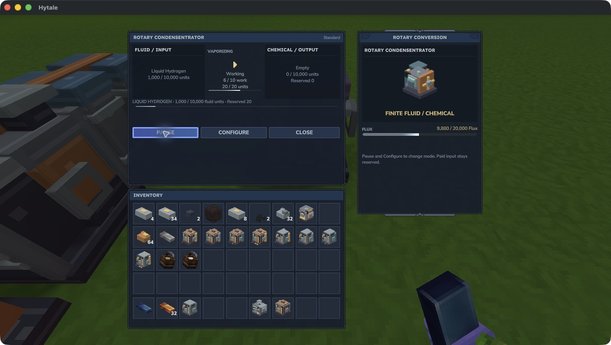
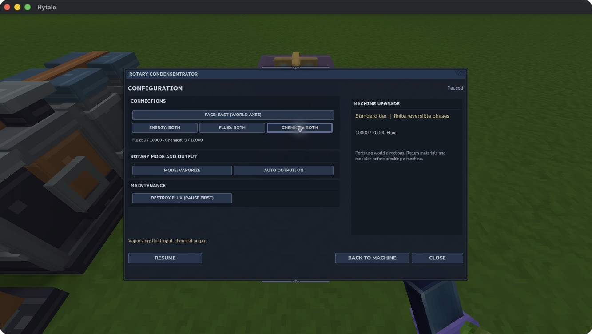
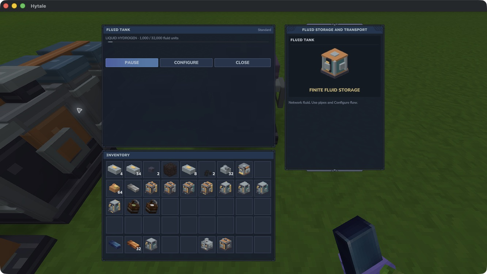
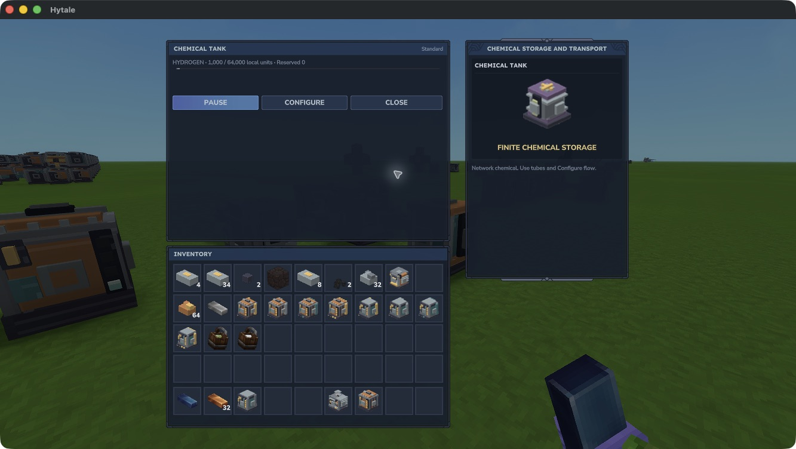

# Rotary conversion

The **Rotary Condensentrator** converts matching fluids and chemicals in either direction. Its two finite stores stay separate: fluid on the left, chemical on the right. Both directions consume Flux.

This is a development feature. A native **1,000 water → 1,000 water vapor → 1,000 water** loop spent exactly **20,000 Flux**, with paid work retained across normal reload in both modes. A real Separator source also supplied **1,000 Hydrogen → 1,000 Liquid Hydrogen → 1,000 Hydrogen**, spending another **20,000 Flux** through the Rotary, including a normal reload of the stored liquid. Complete survival acquisition, human listening and real multiplayer remain under acceptance.

*The Rotary sits between a Chemical Tank on the left and a Fluid Tank on the right. Tubes and pipes keep the two media separate. A Dynamo and Separator behind it supply power and the original Hydrogen.*

## Connect the machine

1. Connect a Dynamo or Reservoir through permitted energy faces.
2. Connect a **Fluid Tank through Fluid Pipes** to the fluid side, and a **Chemical Tank through Chemical Tubes** to the chemical side. Configure uses world directions; either network can use any permitted face.
3. Keep receiving tanks enabled with **Auto output Off**. Enable Auto output on a source tank when it should supply its network. The Rotary needs Auto output On to route its product downstream.
4. Open the Rotary, pause it and select **Configure → Mode**. **Vaporize** consumes fluid and produces chemical. **Condense** consumes chemical and produces fluid.
5. Resume. The panel shows both quantities, reserved input, paid work and Flux. An empty local output can mean the product has already moved into a pipe, tube or tank.

The development command `/emberworks x y z` opens an owned machine within eight blocks. Closed faces, paused or unloaded components and ownership mismatches stop the affected route. Match the medium and identity at every destination: water and Liquid Hydrogen cannot share one fluid store.

*The liquid input remains reserved while work is paid. Unsupported bucket controls disappear for this network-only fluid. This view is from Emberworks 0.3.0-dev on Hytale 0.7.2.*

## Modes and quantities

| Setting | Behavior |
|---|---|
| Vaporize | 20 matching fluid units → 20 chemical units |
| Condense | 20 matching chemical units → 20 fluid units |
| Work per batch | 10 loaded steps of 0.1 seconds |
| Cost per step / batch | 20 / 200 Flux |
| One direction, 1,000 units | 50 batches; 10,000 Flux |
| Fluid / chemical capacity | 10,000 units each |
| Flux capacity | 20,000 |

A mode change requires a paused machine with **no unfinished paid batch**. Finish that batch in its saved mode first. Pausing, unloading, losing power or a blocked local output preserves paid progress and reserved input. The machine preflights its whole local result before spending another work step; downstream pipes and tanks also retain finite quantities when their destinations refuse.

*Pause and finish paid work before changing mode. Port directions use world axes.*

## Water and Hydrogen

For the water route, pause the Rotary while holding an ordinary full native water bucket and select **Load held full bucket**. One bucket supplies 1,000 water units and returns an empty bucket. Vaporize into a chemical receiving tank, then pause after the batch finishes, select Condense and reverse the source/receiver tank settings to return water.

Only ordinary water has a supported bucket exchange at the Rotary. Recovery needs a whole **1,000 unreserved water units**. Paid input cannot be recovered from an unfinished batch. Milk and Mosshorn milk are not Rotary feedstocks.

[Water separation](separation.md) provides Hydrogen and Oxygen in separate chemical stores. Route Hydrogen to a condensing Rotary and collect **Liquid Hydrogen in a Fluid Tank**. Liquid Hydrogen uses pipes; Hydrogen uses tubes. These media have no supported bucket or item carrier, and their tanks hide carrier controls. Keep the Separator's Oxygen product in a separate chemical store.

*The same finite quantity moved between distinct fluid and chemical stores. Neither direction generates free Flux.*

## Conversion catalog and crafting

The implemented reversible identities are Brine, Chlorine, Ethene, Hydrofluoric acid, Hydrogen, Hydrogen chloride, Lithium, Oxygen, Sodium, Steam, Sulfur dioxide, Sulfur trioxide, Sulfuric acid, Superheated sodium, Uranium hexafluoride, Uranium oxide, Water vapor, Deuterium, Fusion fuel and Tritium.

**Water vapor pairs with ordinary water.** The other identities use distinct local liquid phases. This catalog does not create native world fluids, buckets or acquisition routes for later chemicals; those sources remain in development. Water and Separator-produced Hydrogen are the representative native routes exercised so far.

The base machine's authored Workbench recipe is **12 Iron Ingots, 8 Copper Ingots, 4 Tempered Alloy and 1 Wooden Bucket**. See [Workbench crafting](../crafting.md). Rotary tiers, installers and Speed/Efficiency modules are not supported in this build.

Finish paid work, empty both media and use the explicit maintenance controls to deal with remaining Flux before removal. Back up the world, player data and matching JAR together before changing builds; older builds may not understand the new phase stores. See [installation and compatibility](../installation.md).
