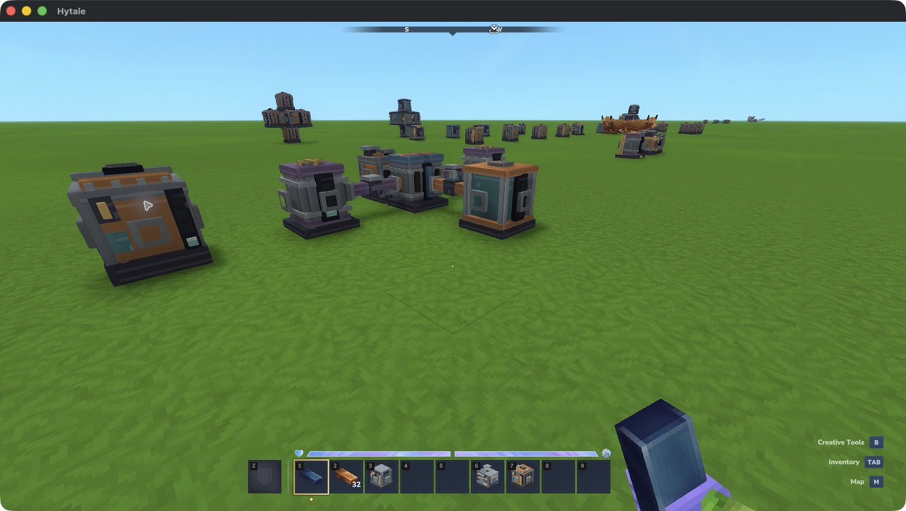
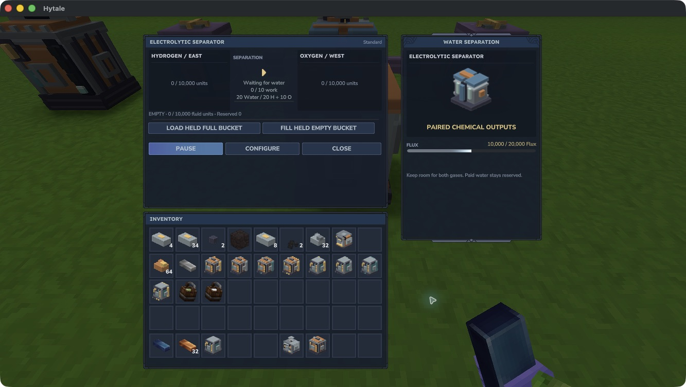
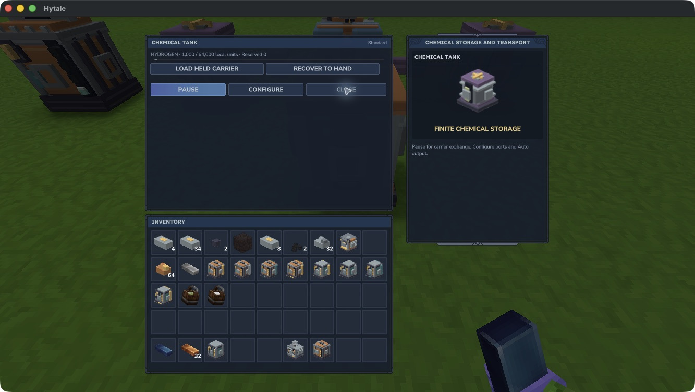
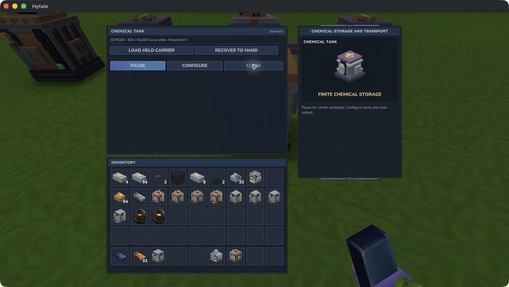

# Water separation

The **Electrolytic Separator** turns finite water into two separately stored chemicals: **Hydrogen** and **Oxygen**. Both outputs need room. The machine never dumps an unwanted product to keep running.

This development feature requires the supported test setup. A native bucket → fluid pipe → Separator → two chemical tanks loop has produced exactly **1,000 Hydrogen and 500 Oxygen for 10,000 Flux**, including a paused paid batch across normal reload. The test used a granted ordinary water carrier. Complete survival crafting, ordinary Use, human listening and real multiplayer remain under acceptance.

*A native test arrangement. Water enters from the front tank; two chemical routes keep the products separate. The Dynamo supplies Flux. A small fixture crate holds the returned empty bucket.*

## Set up the loop

1. Place a Separator and connect a Dynamo or Reservoir through permitted energy faces.
2. Connect its **East output to a Hydrogen tank** and **West output to an Oxygen tank**, using Chemical Tubes. These are world directions, shown in **Configure**.
3. Keep both receiving tanks enabled with **Auto output Off**. All connected components must be loaded, available and owned by the same player.
4. Supply ordinary water through a Fluid Pipe, or pause the Separator, hold a full native water bucket and select **Load held full bucket**. One bucket supplies **1,000 water units** and leaves an empty bucket in hand.
5. Resume the Separator. Its panel shows water, reserved water, paid work, both local gas buffers and Flux. The gases move into their matching output routes.

The development command `/emberworks x y z` opens the owned machine within eight blocks. **Configure** exposes energy, fluid input and the fixed chemical output faces. Close a face to stop its route. A new source Fluid Tank keeps its water until Auto output is enabled or an explicit Input pipe pulls from it.

*The two output buffers and water input each hold at most 10,000 units. Output-tank quantities are shown by opening those tanks; an empty local output can mean its product has already moved downstream.*

## Quantities and paid work

| Contract | Quantity |
|---|---:|
| Water per batch | 20 units |
| Hydrogen per batch | 20 units |
| Oxygen per batch | 10 units |
| Loaded work per batch | 10 × 0.1s steps |
| Flux per work step | 20 |
| Flux per batch | 200 |
| One complete bucket | 50 batches; 1,000 Hydrogen + 500 Oxygen; 10,000 Flux |

The input and outputs use the recipe's own local units. An active batch keeps its saved contract. Pausing, unloading or losing power preserves paid progress and its water reservation. A full output stops further work before another water or Flux debit.

Pause before filling an ordinary empty bucket from the input. Recovery needs a whole **1,000 unreserved water units**. It does not return partial buckets or the water committed to unfinished work. Milk and Mosshorn milk are refused.

*One finite water input produced both retained products. Hydrogen and Oxygen currently have no item-carrier exchange; keep them in separate Chemical Tanks and use chemical transport. Charcoal and Cobalt bars cannot recover these gases.*

## Crafting and limits

The authored Workbench recipe is **12 Iron Ingots, 6 Copper Ingots, 4 Tempered Alloy and 1 Wooden Bucket** for one base Separator. See the [actual Workbench table](../crafting.md). Native survival acquisition/unlock acceptance remains incomplete.

Only ordinary water separation is implemented in this development build. Other feedstocks and later chemical consumers are not available through this machine yet. Empty all three buffers, finish paid work and discharge remaining Flux before removal. Back up the complete paired world, player data and matching JAR before changing builds; older builds may not read the new saved buffers.
