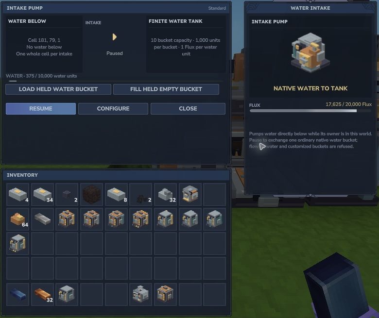

# Water and portable equipment energy

These are **experimental supported-Lab features**. They require the current guarded native adapter, owner presence and loaded blocks. Broader world/provider support, region filling, other fluids and multiplayer acceptance remain incomplete.

## Intake Pump

The Pump reads the native cell directly below. Source water is 1,000 units; finite levels 1–8 represent 125 units each. A successful whole-cell intake costs one Flux per water unit. Unsupported/flowing fluids, a full tank or insufficient Flux refuse. The local tank holds **10,000 units**.

*The pictured paused Pump retained a finite 375-unit intake. There is no water in the cell below now.*

Pause before native bucket exchange. Loading one ordinary full water bucket adds 1,000 units and leaves the empty bucket; filling one ordinary empty bucket removes 1,000 units. Customized or partly used buckets refuse. The shared controller permits at most one successful Pump/Floodgate world action per two loaded seconds.

## Floodgate

The Floodgate holds the same finite 10,000-unit water tank. It places one whole bucket below as finite level-8 water for **1,000 water + 1,000 Flux**. Both the native block and fluid must be empty. Solid blocks, plants, occupied fluid and partial cells refuse the complete action. It does not create an infinite source, fill an arbitrary region or reset a persisted frontier in this initial slice.

## Charging Plinth and Flux Pack

A Flux Pack stores **10,000 Flux**. Hold one while standing within one horizontal block of your enabled plinth, near its deck height. The controller moves up to **1,000 Flux every two loaded seconds**. The plinth has a 20,000 Flux buffer. Full packs, missing/incompatible held items, unavailable owners or exhausted power stop charging.

*This is a real charged pack after native save/reload. The plinth's energy and the equipment charge are separate stores.*

Use **Charge held pack** for an explicit bounded transfer. **Pause before Return held energy**; this prevents the automatic controller immediately charging it again. Returns preserve energy rather than generating new Flux. The charge survives native inventory movement and supported saved-state recovery. Only the authored held Flux Pack contract is implemented here; equipped armor slots, arbitrary batteries, tools/suits and other providers are not implied.

World-water actions can cause brief stalls in this development build. Sound assets and state bindings are installed; human mix/listening and real multiplayer audience checks remain open.
