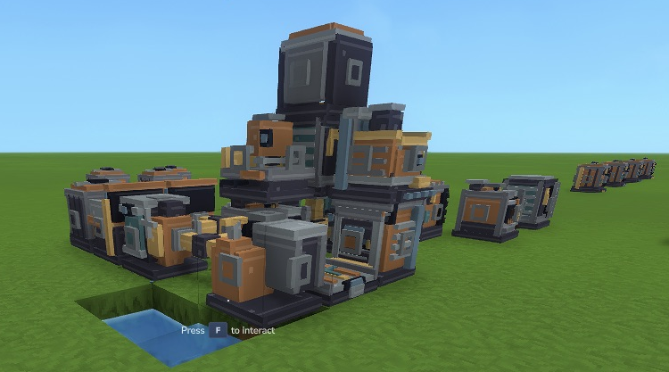
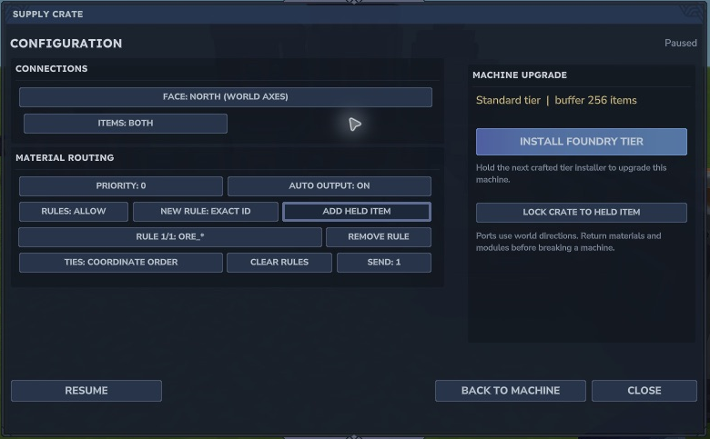
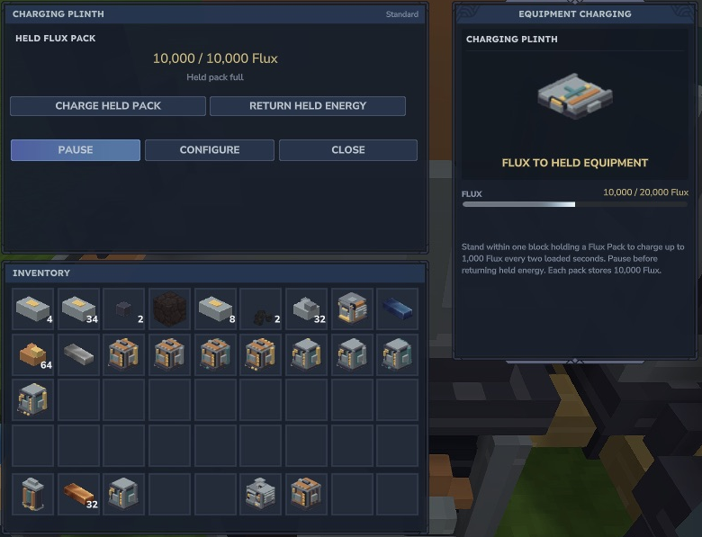

# Native screenshots

All gameplay images in this guide were captured from Emberworks 0.3.0-dev on Hytale 0.7.2. Select any screenshot to open its full size. They are cropped to relevant game/UI content and stripped of ancillary image metadata. The banner/logo are original brand illustration and are not gameplay evidence.

*Compact creative workshop used for development. Read [the first-session guide](getting-started.md) for the actual material loop.*

*Exact/prefix rules, priorities, single-item dispatch and world-axis connections are visible in [the routing guide](features/power-routing.md).*

*Finite station and equipment energy are described beside the controls in [water and equipment](features/water-equipment.md).*
