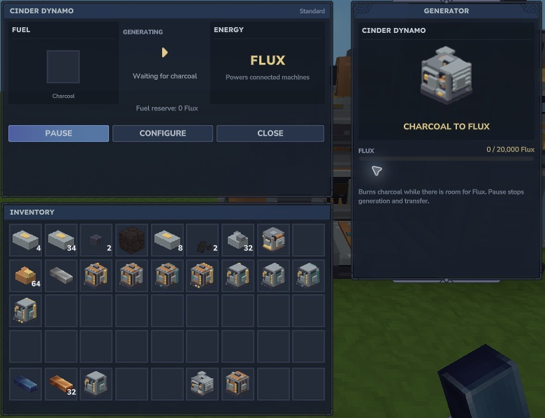
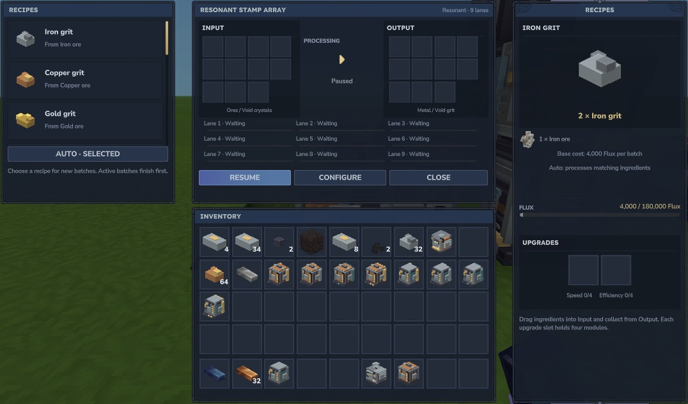

# Your first useful loop

This is a **development walkthrough**. The recipe costs and representative production loop are implemented; obtaining and crafting the entire chain in survival has not yet been accepted. Use the supported test setup and keep its backup. The [progression page](progression.md) distinguishes recipes from verified acquisition.

## Prepare a small workshop

You need a Cinder Dynamo, Flux Rails, a Stamp Mill, an Arc Hearth, charcoal and one iron ore. A Supply Crate and Parcel Ducts are useful after manual processing works. The [crafting table](crafting.md) lists their actual Workbench inputs.

Place the machines on solid ground and connect power with face-adjacent Flux Rails. The machines must belong to the same owner. Ports use world directions; a closed face or a gap stops that connection. Start with the machines paused while arranging inputs.

## Make Flux

Open the Dynamo's native controls and move **one charcoal** into Fuel. Resume it. At shipped defaults that charcoal supplies **20,000 Flux** at up to **1,000 Flux per active second**, while space and connections permit. The remaining burned fuel is retained if generation pauses.

*Fuel goes in the upper-left slot. The example is waiting for charcoal; no fuel has been added for the screenshot.*

## Turn one ore into two bars

1. Put one iron ore into the Stamp Mill's Input. Leave **Auto** selected or select **Iron grit**. Resume the Mill.
2. At base speed the batch needs 100 work steps: **10 seconds of active work and 4,000 Flux**. Collect **two Iron grit** from Output.
3. Put the two grit in the Arc Hearth. Select the matching iron-grit recipe or use Auto. Each grit becomes one iron bar for **1,000 Flux** over **5 seconds of active work** at base speed.
4. Collect **two iron bars**. The whole ore-to-two-bars chain costs **6,000 Flux** with the shipped base recipes and no efficiency changes.

*This screenshot shows a Resonant Stamp Array with nine lanes. A Standard Mill has one lane. The recipe pane shows the same two-grit batch and its default base cost.*

Scheduler load, insufficient power and blocked outputs can lengthen wall-clock time. Keep room for every output. A full output waits; it does not justify discarding a secondary product. Inputs and paid work belonging to a started batch remain reserved. Choosing another recipe changes new batches; active batches finish their saved choice.

## Add routing, then expand

Once the manual loop works, put Parcel Ducts between production machines and plain-material Supply Crates. Enable Auto output on the source and configure the relevant faces. Use [filters and priorities](features/power-routing.md) to prevent materials going to the wrong machine.

Next make Tempered Alloy in the Alloy Crucible, then modules and installers. More lanes need more power. An installer adds production capacity rather than creating Flux.

Use your configured native **Use** action to open controls; the captured configuration displays F. Ordinary Use-input acceptance remains pending in this development build. An operator can inspect a nearby owned machine with `/emberworks x y z` or configure it with `/emberworks-config x y z`; these are development fallbacks, not a survival acquisition route.
