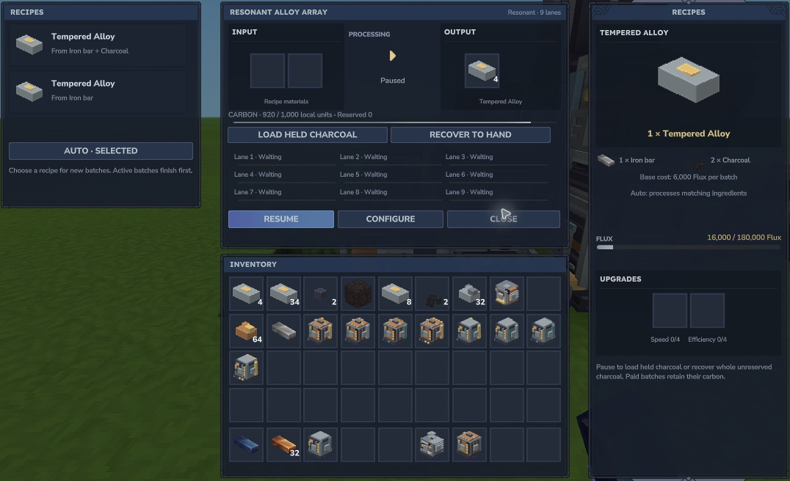

# Progression

Emberworks currently adds machines and processed materials, using stock Hytale ingredients rather than new ore spawns. A valid asset or crafting recipe does **not** establish that every prerequisite has been obtained in survival. The complete survival walkthrough is still under acceptance.

| Step | Implemented route | Useful next result |
|---|---|---|
| Start | Stock iron/copper bars and charcoal → Workbench machine recipes | Dynamo, Rails, Mill and Hearth |
| Enrich | Ten supported metal ores → two grit → two bars | More metal per ore |
| Alloy | Iron bar + two charcoal, or iron bar + 20 local carbon | Tempered Alloy |
| Upgrade | Alloy/copper → modules and Advanced Chassis → installers | More lanes or larger storage |
| Shape | Supported trunks → two planks + bark; gravel + sand → aggregate | Building materials |
| Compress | Yellow crystal → Lumen grit; Void crystal → Void grit; forge with Cobalt binder | Lumen and Dense Void ingots |
| Assemble | Finite native Fieldcraft torch/bed patterns | Conservative automatic crafting |
| Move water | Local Pump/Floodgate tanks and ordinary native buckets | Supported direct intake/discharge tests |
| Carry power | Copper/alloy/Lumen → Flux Pack; Reservoir/alloy/metals → Charging Plinth | Finite held equipment energy |

The [complete crafting inputs](crafting.md) and [106 processing recipes](recipes.md) are taken from the shipped catalog. Reachability of the later stock ores/crystals and the actual Workbench crafting/unlock journey still need gameplay acceptance.

## Carbon and Cobalt binder

A paused Alloy Crucible converts each held charcoal into **10 carbon units**, up to 1,000 units. The carbon recipe reserves **20 units per alloy**. The older direct two-charcoal recipe remains available.

A paused Pressure Forge converts each held Cobalt bar into **200 binder units**, up to 1,000. Its Lumen and Dense Void recipes use **2 binder units per work step** for 100 base steps: **200 binder per batch**. Unreserved whole carriers can be recovered to the held slot; reserved media stays with its paid batch.

*Carbon is a separate finite store. Pause before loading or recovering carriers. The pictured Resonant Array retains previously produced alloy.*

[Fluid networks](features/fluid-networks.md), [chemical networks](features/chemical-networks.md) and [water separation](features/separation.md) have representative native development loops. Larger advanced chains and complete survival progression remain in development.

The [Rotary Condensentrator](features/rotary.md) adds finite, paid conversion between matching fluid and chemical phases. Water/vapor and Separator-produced Hydrogen are the representative native routes; the later chemical sources and complete survival unlock journey remain in development.
